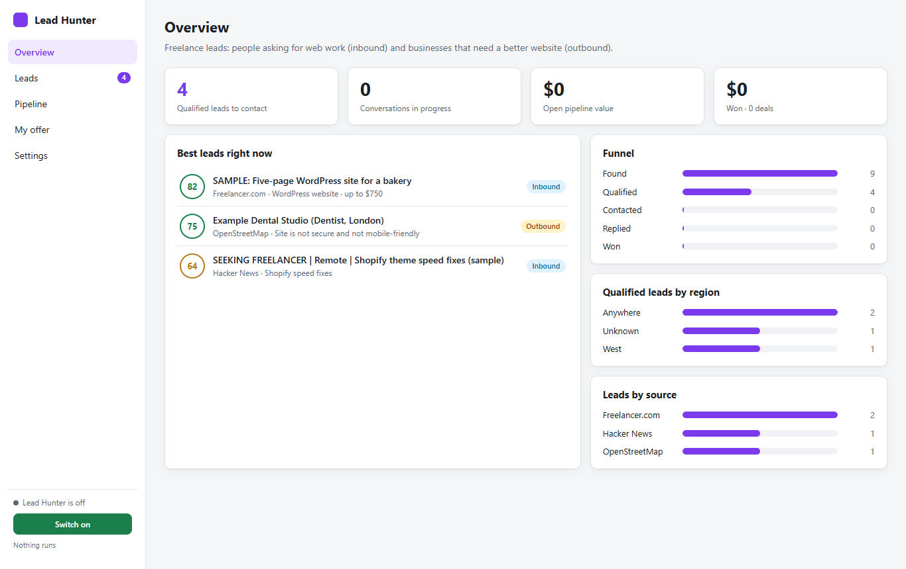
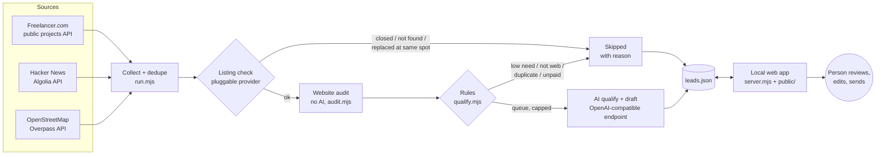
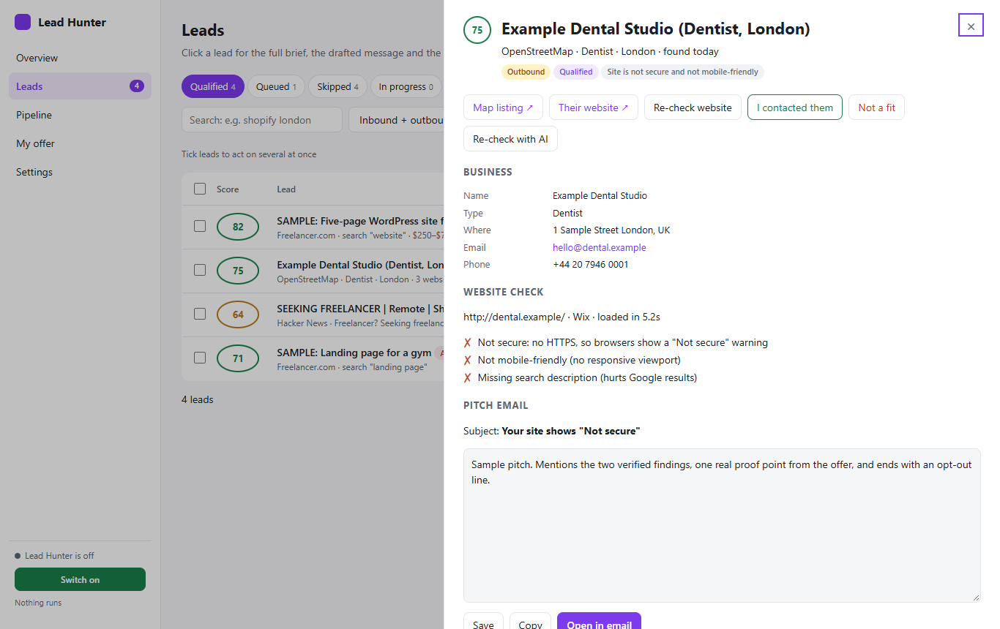

# Lead Hunter

A local tool that finds freelance web-development leads, checks each one against evidence, and drafts a message. A person reviews every lead and decides whether to send anything. It runs on one machine, keeps AI spend under a hard cap, and never contacts anyone by itself.



<sub>All screenshots use the fictional sample data in `scripts/sample-data.mjs`.</sub>

## The problem

Most "lead lists" are guesses. They say a business "has no website" when the map listing is just out of date. They call a site "broken" when a bot check blocked the request. A pitch built on a false claim loses the client in the first line, and sending it at volume damages your reputation faster.

I built Lead Hunter around one rule: **only claim what you can prove, and say how sure you are.**

## Product decisions

| Decision | What it means in the code |
|---|---|
| **Evidence first** | The website audit (`audit.mjs`) uses no AI. It only reports problems a visitor would really see: no HTTPS, no mobile viewport, a parked domain, a stale copyright year. If a site blocks automated checks, the lead is marked *couldn't verify* and the person checks it by hand. It is never marked *broken*. A homepage error only counts if it is still there on a second check. A link on the map listing that points to a missing page is a small finding, not "your site is down". |
| **"No website" stays unverified until a person confirms it** | OpenStreetMap often lacks websites. A guessed domain only counts if the page shows the business's phone number or street address. Until a person clicks "I checked: no website", the pitch prompt is told not to claim the business has no site. |
| **A person approves every send** | The tool drafts messages and the person sends them. There is no email, DM or messaging integration. The app only opens a pre-filled `mailto:` link. The outbound prompt asks for a one-line opt-out at the end of every draft. |
| **Rules before AI** | Reposts, cross-posts, commission-only or unpaid posts, non-web jobs and low-need businesses are skipped by rule (`qualify.mjs`) and never use AI quota. The person can override a rule with "Re-check with AI". |
| **Hard cost caps** | Each run has an AI cap (`aiPerRun`), an audit cap (`auditsPerRun`) and a 15-minute AI time budget. Models that return 429 are skipped for 10 minutes. When every model is rate-limited, the run pauses until the next one instead of counting it as a failure. Inbound and outbound leads take turns in the AI queue so neither starves. |
| **The AI may only use your real offer** | Prompts may only use facts from `offer.json` (services and proof points). They must not invent clients, numbers or prices. |
| **Your edits always win** | Fields the person owns (notes, deal value, an edited pitch, status changes, a website they entered) are never overwritten by a later run (`savePipelineLead` in `lib.mjs`). |
| **Respect sources** | Requests use an honest user agent and small page sizes. The OpenStreetMap source works through one city and category at a time, so each run covers new ground without hammering the free public servers. Projects that close on Freelancer.com are retired automatically, so nobody pitches a job that's already gone. |

## How it works



Running `node run.mjs` (on a schedule, e.g. hourly) does four things:

1. **Collect** new leads from each enabled source in `sources/`. Each source's health is recorded and shown in Settings, so a source that fails quietly shows up there.
2. **Check the listing** of each outbound business, when a listing provider is configured. A closed business, a business that isn't found, or a different business at the same spot gets skipped with the reason. If the listing shows a different website from OpenStreetMap, that website gets audited.
3. **Audit the website** without AI, using the evidence rules above.
4. **Qualify** with AI, within the caps. Inbound posts get a fit score, a summary, red flags and a reply draft. Outbound businesses get a short email built only from their verified findings.

The web app at `http://localhost:4818` is where the person works. You can filter and search leads, open a lead panel (an accessible modal dialog), confirm or correct the "no website" finding, and edit the draft. You can ask the AI about one lead, move leads through a pipeline (contacted → replied → proposal → won/lost), bulk-mark leads "not a fit" with undo, and export CSV. CSV cells are protected against spreadsheet formula injection.



## Stack

Node.js 20.12+ (ES modules, no framework, one dev dependency). Plain HTML, CSS and JS frontend with no build step. Leads are stored in a JSON file, written atomically through a temp file and rename. AI goes through any OpenAI-compatible chat endpoint, such as a local Ollama or LM Studio server, a gateway, or a hosted API. `playwright-core` is used only by the end-to-end test.

## Run it

```bash
npm install
npm run demo          # creates config.json + offer.json from the examples, seeds fictional sample leads,
                      # and starts the app at http://localhost:4818
```

To use it for real:

```bash
npm run setup         # config.json + offer.json from the examples (never overwrites yours)
cp .env.example .env  # set LLM_BASE_URL (and LLM_API_KEY if your endpoint needs one)
# edit config.json: sources, cities/categories, score threshold, caps, model ids
# edit offer.json (or "My offer" in the app): only real services and proof points
npm start             # the app
npm run run-once      # one collect → audit → qualify run now
```

To run it on a schedule, run `node run.mjs` hourly with cron or Task Scheduler. The run exits straight away unless "Switch on" is enabled in the app.

## Tests

```bash
npm test              # unit: 23 checks, no network, writes only to a temp folder
npm run test:e2e      # end-to-end: drives the app in headless Chrome against a throwaway data copy
```

The unit tests cover queue fairness, rule skips, duplicate detection, domain guessing and page matching. They also cover the audit's evidence rules against local HTTP servers: a dead listing link, a homepage error that persists, a blocked check and a one-off error. Listing parsing, same-business matching, distance, verdicts, source health and closed-project handling are covered too. The end-to-end test (19 scenarios) covers filters and search, the lead panel, confirming "no website", the pipeline, bulk actions with undo, CSV export, input validation, path traversal, keyboard focus handling, phone-width layout (390 px), dark mode and console errors. The e2e test needs Google Chrome installed.

## What this public version leaves out, and why

This repo is a cleaned-up copy of a tool I use privately. I removed some things on purpose:

- **Automated Google Maps lookups.** The private version read listings in a headless browser. Google's terms restrict automated access, so here the listing check is a pluggable provider (`listingProvider` in `listing.mjs`). It ships with a `fixture` provider for the demo and tests. An official places API is the right replacement.
- **Reddit as a source, and the browser fallback in the audit.** Retrying a blocked site in a real browser gets close to working around bot protection. Here, a block simply means *couldn't verify*.
- **Volume features.** I removed messaging-app links, follow-up reminders and call scripts. The tool's job is research and drafting. Pacing outreach is the person's job.
- **All real data.** I removed every real lead, research note and log. The tests use fictional names and phone numbers from ranges reserved for fiction.

## What I'd do next

1. **Measure the funnel per source.** Record found → qualified → contacted → replied → won for each source, and drop sources that never convert. Right now I judge sources by feel, which is the decision most worth replacing with data.
2. **An official listing provider.** Map a places API result to the `parseListing` shape. The verdict logic and its tests stay the same.
3. **Track how often "couldn't verify" happens.** If many audits end there, the evidence rules are too strict for some site types, and that should be a visible number rather than a hunch.
4. **CI for the unit tests** on every push. The e2e test stays local because it needs Chrome.
5. **Not doing: auto-sending.** Sending stays a human decision. That's the product, not a missing feature.

## About

Built by Shan Qayyum, a software engineer who builds business systems and is moving toward delivery, product and QA roles. Portfolio: [shanqayyum.com](https://shanqayyum.com) · GitHub: [shan-qayyum](https://github.com/shan-qayyum)

Licensed under the [MIT License](LICENSE).
